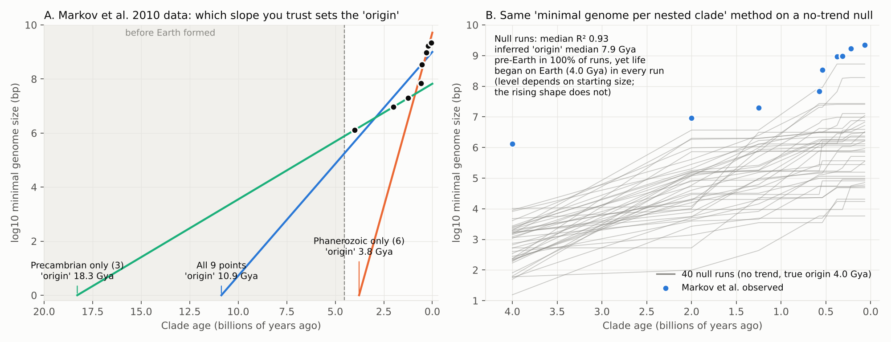

# DNA Before Earth: Critical Review and Research Plan

*Review of the `dna-before-earth` repository (state at commit `ec2b7cd`), October 2026.*
*All pilot numbers below come from `review/pilot/` and can be rerun in about a minute.*

---

## 0. Bottom line

1. **The current repo would not survive peer review.** Several headline numbers are hard-coded rather than computed, and some contradict what the repo's own scripts output. The extended dataset has factual errors. The framing ("The Argument They Can't Answer", "paradigm protection") would get the paper desk-rejected before anyone reads the analysis.
2. **The statistics are not the real weakness. The model is.** Conditional on a straight line, the pre-Earth result is statistically solid (99% inverse-prediction interval 6.5 to 22 Gya for Sharov's points as he plotted them). Marzban et al. (2014) reached "consistent with Earth" through a measurement-error model whose interval widths we could not reproduce; putting the *point estimate* on Earth needs about 1 Gyr of dating error on every point. But the date comes almost entirely from one untested assumption: that complexity grew at the *same rate* in the unobserved interval before the first data point. The data cannot test that assumption. When they can test it, it fails. Fit only the Phanerozoic points and the "origin" is 3.8 Gya. Fit only the Precambrian points and it is 18.3 Gya.
3. **The method cannot see a clock, and reports one when there is none.** Every data point is a living species, so a uniform clock shifts all of them by the same amount and leaves the fitted slope unchanged. Coupled simulations confirm this exactly: the slope is 0.516 with or without a +0.8 log10/Gyr clock. With no clock at all, the method still reports a positive rate with R² around 0.9. For simulation settings that reproduce Markov's observed slope, it infers a pre-Earth origin in 88 to 100% of runs, although life began on Earth in every run. See `results/RESULTS.md`, Section 6.
4. **There is still a strong paper here, just not the one the README announces.** The strongest version is a *calibrated, pre-registered test* of the genome-complexity clock using modern data. That means 10^4 to 10^5 genome sizes, TimeTree ages, ancestral reconstructions, gene-family histories and fossil cell-size proxies. It gives the pre-Earth hypothesis a fair chance to pass, and it is publishable whichever way the result comes out. Sections 5 to 8 lay it out.

### 0.1 Results on real data (added 25 October 2026; full tables in `results/RESULTS.md`)

- **Markov's table rebuilt from 17,198 measured genomes** (GoaT) with TimeTree crown ages. The minima match Markov's values closely. The implied clock depends on which statistic is tracked: the clade minimum gives 1.63 log10/Gyr, the 1st percentile 1.00, and the median only 0.19 (R² 0.53). Typical genomes barely change between nested clades; the trend is in the extremes.
- **Every species as its own focal lineage** (5,212 species on the 2015 Timetree of Life). 99.9% show a positive "clock" with median R² 0.90. In animals, a no-trend model at the animals' own measured rate gives rates of 0.65 to 2.38 log10/Gyr (median 1.25) against the observed 1.56. The lineages also disagree on the origin date: mammals 5.5 Gya, vertebrates 5.9, plants 7.8, arthropods 8.3, fungi 16.4 Gya. A universal clock would give one date.
- **Prokaryotes show stasis** (GTDB R232; 36,268 high-quality isolate species). The median genome is 4.3 Mb, and 13 to 21% of species have genomes smaller than LUCA's estimated 2.5 to 3.0 Mb (65 to 76% of all archaeal species). LUCA to the median modern isolate implies 0.056 log10/Gyr, about 16 times slower than Sharov's rate.

### 0.2 Pre-registered and exploratory tests (added 25 October 2026)

- **Pre-registration** (`prereg/WP4_preregistration.md`) committed at 11:06 UTC, before the eggNOG and fossil data were examined.
- **Gene content (pre-registered, eggNOG 6):** LUCA carried about 2,728 gene families (Moody et al. independently estimate about 2,600). Ancestral gene content grows along the human, *Arabidopsis* and yeast lineages at about 0.19 log10 per Gyr. **Verdict: the clock is not supported.** Log-linearity misses the registered threshold (R² 0.77), and a constant rate extrapolates to one gene family at 22.5 Gya, before the Big Bang.
- **Better no-trend models (exploratory):** in animals every trendless model reproduces the observed nested-minimum slope. In plants an Ornstein-Uhlenbeck model fits far better than Brownian motion (ΔAIC 178) and reproduces the plant slope too.
- **Before LUCA (exploratory):** a terrestrial origin needs the genome to double every 10 to 15 Myr before LUCA (23 to 34 times Sharov's rate). The inferred origin is entirely determined by the prior on that early rate.
- **Marzban et al. (2014):** their prediction bands cannot be reproduced from their printed equations; a query to the authors is drafted (`review/drafts/`, not sent).
- **Fossil genome sizes (pre-registered):** 53 extinct vertebrates with genome estimates and 210 fossil plants (guard cells). As scripted before the data were seen, the registered criteria pass (pooled rate 1.00, CI 0.20 to 1.79). Under the inclusive reading (plant sign counted) they fail. Diagnostics show the pass rests on one stem salamander (*Marmorerpeton*, a phylogenetic prediction); without it the pooled rate is 0.32 (CI −0.14 to 0.78). **Lesson for the registration:** it should have fixed the treatment of relative proxies and required per-group consistency. Both readings are reported.
- **Manuscript draft:** `paper/manuscript.md`.

---

## 1. The hypothesis as the repo states it

- **Claim:** log10(functional or minimal genome size) along the "leading" lineage rises linearly with time, at about 7.5x per billion years (a doubling every ~340 Myr). Extrapolating back to 1 bp gives about 9.8 Gya (Sharov 2006), 10.9 Gya (Markov et al. 2010, 9 points) or 11.2 Gya (the repo's 14 points). All of these are before Earth formed (4.54 Gya).
- **Supporting moves in the repo:** Monte Carlo and bootstrap ("100% pre-Earth"), alternative curves (logistic, quadratic, hyperexponential), a "3x faster early rate" scenario, a threshold table, a random-assembly probability argument, and a "data provenance" argument that critics who accept GenBank data must accept the conclusion.

---

## 2. Reproducibility audit (what a referee will find first)

I re-ran both scripts unchanged (numpy 2.5, scipy 1.18). Items marked **Blocker** must be fixed before anything is shared as science.

| # | Severity | Finding | Evidence |
|---|---|---|---|
| 1 | **Blocker** | README says the Markov 9-point R² is **0.914**. That is Markov et al.'s published Pearson **r** (their paper labels it R²); R² is **0.836**, which is what the repo's own script computes. The README presents r as the repo's R². | Markov et al. 2010 p. 127; `extended_analysis.py` |
| 2 | **Blocker** | The hyperexponential row (R² = 0.979, origin ">10 Bya") is hard-coded. 0.979 is Markov's published r. The parameters were transcribed faithfully, but the paper's C = 1.069 x 10^8 is a typo (refit: about 1.07 x 10^6 bp), which is why the script computes R² = -54. Refitted correctly, the curve levels off near 1 Mb and never reaches 1 bp, so ">10 Bya" is wrong. | Analysis 5 output; `results/RESULTS.md` Section 3 |
| 3 | **Blocker** | "3x faster early rate gives 5.7 Bya" is not computed anywhere in the code (it is 3.5 + 5.70/(3 x 0.877)). README says "Every number in this README is reproduced by these scripts". That statement is false. | grep of `analysis/` |
| 4 | **Blocker** | Logistic "origin 20.5 Bya" is a boundary artifact. The fitted carrying capacity L sits exactly on the arbitrary upper bound (15). Raising the bound changes the answer (L = 17.2, "origin" 21.4). The "1% of L" origin rule is arbitrary. Fixing the lower asymptote at 1 bp builds the conclusion into the model. | pilot `stat_checks.py` section 3 |
| 5 | **Blocker** | Extended dataset errors. (a) *Ashbya gossypii* (9.2 Mb) is used twice: as "Eukaryotes" at 2.0 Gya and as "Fungi" at 1.0 Gya. (b) *Cyanidioschyzon merolae* is unicellular, not multicellular, and its genome is 16.5 Mb, not 13.7 (Matsuzaki et al. 2004). (c) *Genlisea tuberosa* is a flowering plant of about **61 Mb** (Fleischmann et al. 2014). The repo lists it at 82 Mb, which is *Utricularia gibba*'s figure, and uses it for "earliest land plants" at 470 Mya. (d) *Utricularia gibba* is 82 to 100 Mb; the "63 Mb functional" figure has no source. (e) *Prochlorococcus* genomes are 1.66 Mb at the smallest (MED4, Rocap et al. 2003), not 1.44. (f) "Free-living only" follows Markov et al., who exclude only *intracellular* parasites. In ordinary usage *Ashbya gossypii* (a cotton pathogen) and *Pratylenchus coffeae* (a plant-parasitic nematode) are parasites; say so as a disagreement with Markov's criterion. The smallest free-living eukaryote usually cited is *Ostreococcus tauri* at 12.6 Mb. | `data/extended_dataset.csv`, `SOURCES.md`. **Fixed on this branch.** |
| 6 | High | **Sharov's dates are misreported.** Sharov prints no data table and gives mammals no date ("appeared just recently"). His Fig. 1 plots eukaryotes at about 2.1 and mammals at about 0.1 Gya, and eukaryotes 2.05 with mammals 0.10 reproduce all four printed statistics (8.64 + 0.89x, R² 0.97, 7.8-fold). The repo used mammals at 0.0. Markov et al.'s reprint (Table 2) uses 0.125, which matches the intercept only. **Fixed on this branch.** | Sharov 2006 Results and Fig. 1; Markov et al. 2010 Table 2 |
| 6b | High | The CSV files are never read by the code. All data are re-typed inside the scripts. The scripts' 14-point set differs from `extended_dataset.csv` (code has Flowering plants and no Amniotes; the CSV is the reverse). Two different "Sharov" datasets exist: mammals at 0.0 Gya in one script and 0.125 Gya in the other, with different values. | both scripts **Fixed on this branch:** `clock/` reads only `data/*.csv`. |
| 7 | High | The README lists files that do not exist: `paper/genome_clock_paper.docx`, `conversation/`, `visualization/`. | `find` |
| 8 | High | The best-fitting model by the repo's own AIC is the **quadratic** (-12.76 vs -12.00). It has no origin at all: going back in time, genome size reaches a minimum at about 5.9 Gya and then *grows*. That contradicts "every model confirms pre-Earth". Really it shows the extrapolation is arbitrary. With n = 5, AICc for any 3-parameter curve is undefined (n - k - 1 = 0), so none of these model comparisons are meaningful. | `full_analysis.py` Part 5; pilot section 2 |
| 9 | Medium | The bootstrap resamples only 5 points. 9.1% of resamples are silently dropped (fewer than 3 unique points), and both MC and bootstrap discard origins above 50 Gya. "100%" from 5 points is not informative. | Part 8 |
| 10 | Medium | The Monte Carlo only jiggles points around the *assumed* straight line. "100% pre-Earth" means "the straight-line extrapolation is insensitive to the stated measurement errors". It does **not** test whether the straight line is right. | Part 2 |
| 11 | Medium | R² falling from 0.97 to 0.84 to 0.71 as points are added is described as the result "strengthening". It means the scatter around the line grows. The p-value falls only because n grows. | README table |
| 12 | Medium | `sharov_2006.csv` calls *Mycoplasma genitalium* "smallest known free-living", but it is an obligate parasite. | CSV note |
| 13 | Medium | Divergence dates are outdated. Crown Metazoa is about 0.65 to 0.83 Gya (dos Reis et al. 2015), not 1.25. Crown eukaryotes (LECA) are about 1.67 to 1.80 Gya (Kay et al. 2025), not 2.0. Crown tetrapods are about 352 Mya, not 375. See Section 4.4. | |
| 14 | Framing | "Nobody ever actually tested whether he was wrong" is false. Marzban et al. (2014) is a published statistical re-test, and Sharov & Gordon answered it in 2018. Markov et al. (2010) and Skladnev et al. (2013) reanalysed the data, and Korotayev (2026) revisits it. See Section 4.1. | |
| 15 | Framing | The README says Markov et al. "strengthen" a pre-Earth origin. They give no date of their own: they wrote that Sharov's "at least 7 Ga ... can be considered rather seriously (but only if such extrapolation itself is assumed to be reliable)" and left extrapolation "beyond the scope of this paper". Their preferred biexponential has no finite 1 bp crossing. The 10.9 Gya figure is the repo's own straight-line fit to their table. | Markov et al. 2010 pp. 128-129, 136 |

**What is already good and worth keeping:** open code and data, an explicit limitations list, flagging the Sharov/Markov metric difference, flagging the coefficient mismatch with Sharov, the threshold table (which honestly shows the date depends on the assumed starting size), and the instinct to turn critics' verbal objections into quantitative tests.

---

## 3. Scientific critique, ranked by how much each point matters

### 3.1 Decisive: the rate before the first data point is unconstrained

Every origin estimate is "first data point + (log10 size of first point) / (assumed early rate)". The data say nothing about the early rate, and where the data *can* test rate constancy, it fails:

| Fit used | Slope (log10 per Gyr) | "Origin" | Note |
|---|---|---|---|
| All 9 Markov points | 0.83 | 10.9 Gya | |
| Phanerozoic only (6 pts) | 2.57 | **3.8 Gya** | Predicts the 4 Gya bacterium at 10^-0.6 bp. That is wrong by 6.7 orders of magnitude. |
| Precambrian only (3 pts) | 0.43 | **18.3 Gya** | Older than the universe |
| Drop the bacterium (leave-one-out) | 1.32 | 7.0 Gya | One point moves the answer by 4 Gyr |

*(pilot `stat_checks.py` sections 4 and 5; Figure, panel A)*

So rates differ about 6-fold between segments of the observed record, and the answer moves between "on Earth" and "before the Big Bang" depending on which segment you trust. Sharov's reply to Koonin ("with scenario (b), life originated even earlier than that. Thus, separate handling of prokaryotes and eukaryotes does not bring the predicted date of life origin closer to present") assumes the slow rate continued all the way back to 1 bp. That is the very assumption in question.

**The same method on other complexity metrics gives impossible answers.** Take LUCA at about 4.2 Gya with about 2,600 proteins (Moody et al. 2024) and humans with about 20,000 protein-coding genes. A constant-rate gene-count clock then puts the origin at **20.4 Gya**. With constrained DNA (LUCA ~2.3 Mb to human ~330 Mb) it is **16.6 Gya**. Both are older than the universe (13.8 Gyr). Any method that can return dates older than the universe proves its own constant-rate assumption false somewhere. Once rates are allowed to vary, nothing in the data anchors the extrapolation. *(pilot section 7)*

**What rate would a terrestrial origin require?** Going from 1 bp to Sharov's 0.5 Mb prokaryote by 3.5 Gya, starting at 4.4 Gya, needs about 7x Sharov's average rate (a doubling every ~50 Myr). Going to Moody's 2.5 Mb LUCA by 4.2 Gya needs about 24x to 37x (a doubling every 9 to 14 Myr). This is the real, interesting, quantitative question the project can own: *how fast did pre-LUCA evolution have to be, and is that implausible?* *(pilot section 6)*

### 3.2 Modern genomes are not ancestral genomes

Every point is a **living** organism's genome placed at the **age of its clade**. *Pelagibacter* (1.3 Mb) is not a 4-billion-year-old genome. It is a highly streamlined product of 4 Gyr of evolution. Genome reduction is common (Wolf & Koonin 2013), and so is genome expansion. The y-value of a modern representative is neither an upper nor a lower bound on the ancestor's genome. A defensible time series needs **ancestral reconstruction** (phylogenetic comparative methods, gene-content reconstruction) or **fossil proxies** (cell size to genome size). The current work has neither.

### 3.3 The nested-minimum and leading-edge construction manufactures a log-linear trend

Markov's points are minima over **nested** clades (Primates within Mammals within Amniotes, and so on down to all life). An older clade contains every younger one, so its minimum can only be lower: monotonicity is guaranteed by construction. It goes further than that. For an *undirected* random walk on a branching tree, the extreme value over a clade moves **linearly in time** (the classical result for branching Brownian motion; speed of about sigma x sqrt(2 x lambda)). A log-linear "clock" is therefore the *expected* signature of no trend at all.

Pilot (`null_bbm.py`): log10 genome size does a random walk with zero drift on a Yule tree. Life starts at 1 Mb, 4.0 Gya, so the true origin is known and terrestrial. Apply Markov's construction at Markov's clade ages:

| Null variant | Positive slope | Median R² | Median inferred "origin" | Inferred pre-Earth |
|---|---|---|---|---|
| Random focal lineage, no floor | 100% | 0.96 | 7.1 Gya | 100% |
| "Most complex" focal lineage, no floor | 100% | 0.97 | 5.5 Gya | 98% |
| Random focal, reflecting floor at 300 kb | 100% | 0.69 | 28 Gya | 100% |
| "Most complex" focal, floor at 300 kb | 100% | 0.82 | 8.8 Gya | 100% |

**Update after the full calibration (`scripts/run_calibration.py`, `results/RESULTS.md` Section 6).**
- **The pre-Earth rate depends on parameters.** Across a grid of sigma (0.25 to 1.0) and lambda (1.5 to 2.5), the no-clock false-positive rate for "pre-Earth" ranges from 16% to 100%, depending on sigma, lambda and the assumed starting size. For settings whose no-clock slope matches Markov's observed 0.83, it is 88 to 100%.
- **The deeper result does not depend on parameters.** A *uniform* clock is invisible to any statistic built from living species. All extant genomes carry the same total growth, so clade minima, maxima and representatives all shift by the same constant. The slope reflects trait spread and diversification, never the clock rate. True clock rates of 0, 0.4, 0.8 and 1.2 all give fitted slopes of about 0.8, and only the true ancestral series recovers them.
- **Selecting the most complex living lineage, as Sharov did, biases even the true ancestral series.** With no clock, the maximum-genome lineage's ancestors show apparent rates of 0.25 to 1.65 log10/Gyr.

### 3.4 Genome size is a poor and inconsistently defined complexity metric

- The C-value enigma: genome size varies over 100,000-fold among eukaryotes and tracks cell size, nucleotypic effects and drift, not organismal complexity. Examples are lungfish (~40 Gb) and *Paris japonica* / *Tmesipteris* (~150 Gb). Lynch & Conery's drift-barrier and mutational-hazard framework explains much of the variation with effective population size, not complexity.
- Sharov's "functional non-redundant" fraction is defined differently for every point: 75% of *C. elegans*, a third of fugu (by "gene loci"), and 15% of human (transposon-free). That is not one metric.
- Markov's metric (total genome of the smallest member) is a different quantity again. Mixing the two in a 14-point regression is not defensible.
- Section 3.1 shows the conclusion swings by 10 Gyr depending on the metric, so metric robustness is not a nice-to-have. It is the test.

### 3.5 Early complexity cuts both ways

Mushegian's "early overload" point is real. LUCA was already a complex cell: at least 2.5 Mb and about 2,600 proteins, about 4.2 Gya (Moody et al. 2024; 95% CI 4.09 to 4.33). But LUCA's genome already sits inside the range of modern free-living prokaryotes. Prokaryote genome size behaves like an equilibrium between gene gain and deletion bias (Sela, Wolf & Koonin 2016). So the prokaryote-only era shows **stasis**, as Koonin argued, and the constant-rate model is contradicted in the very era closest to the extrapolation. Fossil proxies tell the same story in a different group: land-plant genome sizes show no steady within-lineage increase over 400 Myr (Lomax et al. 2014). A complex LUCA soon after Earth became habitable (liquid water by about 4.4 Gya, Wilde et al. 2001) means early evolution was fast. Panspermia is one explanation for that, but the data do not single it out. WP3 should quantify the prokaryote stasis directly from GTDB.

### 3.6 The probability "wall" argument should be removed from the scientific paper

(1/4)^N is the probability of one *specific* sequence. No origin-of-life model proposes assembling a 300 kb genome at random. The relevant quantity is *functional information*: the fraction of sequence space with a given function (Szostak 2003; Hazen et al. 2007). It is measured experimentally at around 10^-11 for ATP binding in random 80-mers (Keefe & Szostak 2001). Ligase ribozymes have also been isolated directly from random RNA pools. More importantly, the argument is **independent of the clock** and does not favour a pre-Earth origin: 5 extra billion years, or a whole galaxy, change 10^-180,618 by a negligible amount. Referees will read this section as an intelligent-design probability argument and stop taking the rest seriously.

### 3.7 "DNA before Earth" is not even what the hypothesis says

Sharov's claim is about *heritable information* (life), extrapolated to a "1 nucleotide" genome. DNA almost certainly came after RNA. Even if the clock were right, the title would be wrong.

### 3.8 Framing

The data-provenance argument ("accept GenBank, accept the conclusion") is a non sequitur. Critics accept the *measurements*. They reject the *inference*: constant rate, extant species as ancestors, and extrapolation 3x beyond the data. Kuhn, "paradigm protection", the critics-scorecard table, the "Argument They Can't Answer" heading, the theological material and the "AI shows" headline all signal advocacy. For the paper, cut all of it. The philosophy essay can live separately, clearly labelled as opinion.

---
## 4. Literature and data

*Verification note: facts below were checked against abstracts, search-indexed text of the sources, publisher pages and database home pages. Full texts could not be opened from the analysis environment, so confirm exact figures and quotes against the full paper before citing.*

### 4.1 The core dispute

| Work | What it actually says | Implication for the paper |
|---|---|---|
| **Sharov 2006**, *Biol Direct* 1:17, doi:10.1186/1745-6150-1-17 | Fig. 1 legend: "log10(y) = 8.64 + 0.89·x ... R^2 = 0.97"; 7.8-fold per Gyr. Origin "10 billion years ago" *if* the "strong exponential hypothesis" holds; his own sensitivity analysis gives "from 7 to 13 billion years". **No data table**: values are in prose, and mammals get no date (plotted at about 0.1 Gya). "This regression cannot be viewed as a proof of the exponential hypothesis." Chose parasites "to get the most conservative estimate"; excluded plants because of polyploidy/redundancy and because they "did not increase as fast as in vertebrates". p = 10^-126 for "400 bp DNA" is stated with no derivation; it is not 4^-400 (about 10^-241). | Replicate with his plotted ages. Selecting "the best performing groups" is selection on the outcome (Section 3.3). |
| **Open reviews (2006)**: Koonin, Adami, Mushegian | **Koonin:** "we have no evidence whatsoever that the maximum genome size of prokaryotes increased during that enormous time span or in the time elapsed since"; proposes "an early explosive phase ... followed by stasis"; "terrestrial origin around 4 billion years ago should be taken as the null hypothesis". **Adami:** "how not to analyze data"; "a piecewise exponential would be a more reasonable assumption"; the initial "step ... from zero to finite" complexity decides the origin. Sharov's only reply to the piecewise point is "see reply #1 to Eugene Koonin". **Mushegian:** early life looks "overloaded with evolutionary innovation"; "I do not see any striking arguments for panspermy in this work"; the clock approach is "qualitatively correct" but its exponential form "remains to be seen". | These are the hypotheses to test (H0b; P6), not opponents to score against. |
| **Markov, Anisimov & Korotayev 2010**, *Paleontol J* 44:363, doi:10.1134/S0031030110040015 | Nine nested groups (Table 1, all rows verified). Exponential fit r = 0.914 (labelled R²; R² = 0.836); biexponential r = 0.979, with a typo in the printed constant C. "Neither increased complexity, nor increased genome size are uniform evolutionary tendencies." No date of their own: Sharov's "at least 7 Ga" "can be considered rather seriously (but only if such extrapolation itself is assumed to be reliable)"; extrapolation is "beyond the scope of this paper". Excludes only intracellular parasites. | Do not cite them as supporting a pre-Earth origin; cite their caveat. Their own best model has no finite origin. |
| **Sharov & Gordon 2013** (arXiv:1304.3381); **2018** chapter in *Habitability of the Universe Before Earth*, doi:10.1016/B978-0-12-811940-2.00011-3 | 2013: origin "9.7 ± 2.5 billion years ago"; doubling "about every 376 million years" (which implies 0.80 log10/Gyr, inconsistent with the 0.89 slope in the same figure); hyperexponential corrections would push it "close to the origin of our galaxy". The ±2.5 is attributed to Sharov 2006, which actually says 7 to 13 Gyr. 2018 chapter: closed access, not verified; an abstract snippet says it criticises Marzban's measurement-error models for assuming uniform, independent errors. | The authors know the interval objection. The new paper must go beyond it, to structural uncertainty and null calibration. |
| **Marzban, Viswanathan & Yurtsever 2014**, *Biol Direct* 9:1, doi:10.1186/1745-6150-9-1 (preprint arXiv:1306.0071, "Life After Earth") | Structural measurement-error model with **λ = 1 + σ_w²/σ_b²** (eq. 6), the attenuation factor (inverse reliability ratio). Sharov's points with eukaryotes at 2.05. OLS origin "about 9.5"; OLS prediction band reaches "7 billion". Their dating-error estimate σ_w ≈ 0.5 Gyr gives λ = 1.14, a corrected point estimate of 8.5, and a band that "includes 4.5 billion". A point estimate of 4.5 needs λ "about 2.7". Wolf called it "an important and useful tutorial ... rather than an earnest attempt to show that the origin of Earth before life is compatible with the available data". | Our λ for 4.5 Gya is the same quantity (2.69). It implies about 1 Gyr of dating error per point (1.8 Gyr under their eq. 6, more than the spread of the dates). **Our reproduction of their bands from eqs 8-9 as printed does not reach 4.5 at λ = 1.14 (it reaches 5.6)**; the last term of eq. 9 looks suspect. Confirm before citing, ideally with the authors. |
| **Skladnev, Klykov & Kurakov 2013** (*Evolution: Development within Different Paradigms*, pp. 249-256) | Refit Markov's nine points with a four-phase S-curve (fast growth 2 to 0.94 Ga, slowing after the Cambrian); R² 0.972 (0.994 on logs). They assume an origin on Earth, starting from 1.3 Mb at 4 Ga, and give no origin date. | Another sign that about 9 points cannot pin down the curve shape. |
| **Korotayev 2026**, *J Big History* 9(3), doi:10.22339/jbh.v9i3.9301 (abstract only; full text not accessed) | MGS growth is "better described as exponential" for about 3 Gyr. The apparent hyperbolic acceleration is a "Weber-Fechner" artifact. | Current; cite it and engage with it. |
| **Commentary (2013)**: MIT Technology Review, "Moore's Law and the Origin of Life"; Pigliucci, "a study in demarcation"; PZ Myers (Pharyngula) | Treated as a borderline-science case; accused of cherry-picking taxa. | Shows the idea was noticed and judged, not ignored. |
| **Extreme-value / passive-trend theory**: McShea 1994; Gould 1996; McShea & Brandon 2010; McShea, Wang & Brandon 2019; branching random walks (Hammersley 1974; Biggins 1976; Bramson 1978) | The maximum of a branching random walk advances linearly in time. Passive trends can be detected with McShea's minimum, ancestor-descendant and subclade-skew tests. | **No source was found applying this to Sharov or Markov.** The Section 3.3 null-model argument looks novel. Confirm this with a full Google Scholar citation search of Sharov 2006 before claiming priority. |

### 4.2 Wider literature the paper must engage

**Early life and LUCA**
- **Moody et al. 2024**, *Nat Ecol Evol* 8:1654. LUCA about 4.2 Ga (4.09 to 4.33). Genome at least 2.5 Mb (2.49 to 2.99), about 2,600 proteins. doi:10.1038/s41559-024-02461-1
- **Weiss et al. 2016**, *Nat Microbiol* (355 families, later largely disputed). **Crapitto et al. 2022**, *Ecol Evol* 12:e8930: eight LUCA reconstructions barely agree with each other, so treat LUCA gene content as uncertain.
- **Oldest evidence for life:**
  - Generally accepted: Dresser Formation, about 3.48 Ga (Djokic et al. 2017).
  - Contested:
    - zircon graphite at 4.1 Ga (Bell et al. 2015)
    - vent tubes at 3.77 to 4.28 Ga (Dodd et al. 2017)
    - Isua "stromatolites" at 3.7 Ga (Nutman et al. 2016, rebutted by Allwood et al. 2018)
    - graphite older than 3.95 Ga (Tashiro et al. 2017)
- **Habitability:** the Moon formed at least 4.51 Ga (Barboni et al. 2017). Liquid water by about 4.4 Ga (Wilde et al. 2001).
- **Eukaryogenesis:** LECA radiated 1.80 to 1.67 Ga, with mitochondrial endosymbiosis about 2.2 Ga (Kay et al. 2025, *Nature*). LECA gene-content estimates run about 6,400 to 12,900 orthogroups, with no consensus (Richards et al. 2024).

**Genome size, complexity and trends**
- **Lynch & Conery 2003**, *Science* 302:1401. Genome complexity can arise passively through drift in small populations.
- **Oliver et al. 2007**, *Genome Res* 17:594. Genome size evolves proportionally to its size: a multiplicative random walk, the H0a null.
- **Wolf & Koonin 2013**, *BioEssays* 35:829: short bursts of complexification followed by long reduction. **Sela, Wolf & Koonin 2016**, *PNAS*: prokaryote genome size is an equilibrium.
- **McShea 1994**, *Evolution* 48:1747: driven versus passive trends, with explicit tests (minimum, ancestor-descendant, subclade skew). Use these tests directly in WP2 and WP4. Also McShea & Brandon 2010 (ZFEL).
- **Maynard Smith & Szathmáry 1995**; **Szathmáry 2015**, *PNAS* 112:10104: complexity rises in major transitions (supports H0b).

**Tempo of early evolution**
- **Vetsigian, Woese & Goldenfeld 2006**, *PNAS* 103:10696: communal, horizontal-transfer-driven evolution before vertical descent. A mechanism for a fast pre-LUCA rate.
- **Spiegel & Turner 2012**, *PNAS*: life's early start says little about how likely abiogenesis is, because the prior dominates. **Kipping 2020**, *PNAS*: Bayes factor of at least 3 favouring fast abiogenesis.

**Functional information (to replace the (1/4)^N argument)**
- **Szostak 2003**, *Nature* 423:689; **Hazen et al. 2007**, *PNAS* 104:8574.
- **Keefe & Szostak 2001**, *Nature* 410:715: about 1 in 10^11 random 80-mers bind ATP.

**Panspermia feasibility (for WP5 priors)**
- **Adams & Spergel 2005**, *Astrobiology* 5(4): rock exchange within a birth cluster.
- **Belbruno et al. 2012**, *Astrobiology*: weak-transfer lithopanspermia.
- **Kepler-444**: 11.2 ± 1.0 Gyr, the oldest known system of terrestrial-size planets (Campante et al. 2015, *ApJ* 799:170).

### 4.3 Data inventory

| Need | Source | Scale (latest found) | Use in plan |
|---|---|---|---|
| Eukaryote genome sizes | **Genomes on a Tree (GoaT)**, goat.genomehubs.org (Challis et al. 2023) | All eukaryotes, with phylogenetic gap-filling; API and command line | WP3 master table |
| Animal C-values | **Animal Genome Size Database**, genomesize.com | 6,534 species, 8,416 records | WP3 |
| Plant C-values | **Kew Plant DNA C-values**, release 7.1 | 12,273 species | WP3; plant lineage for P4 |
| Fungal genome sizes | Fungal Genome Size Database (Kullman et al. 2005); NCBI assemblies | About 2,400 entries | WP3 |
| Prokaryote genomes | **GTDB R11-RS232** (April 2026), with CheckM completeness metadata | 901,341 genomes, 199,923 species clusters | WP3 stasis test; P6 |
| Assemblies, any taxon | **NCBI Datasets** (command line and API) | All of GenBank and RefSeq | WP3 cross-check |
| Divergence times | **TimeTree 5** (Kumar et al. 2022) | 137,306 species, node ages with confidence intervals | Node ages throughout |
| Topology | **Open Tree of Life** v15.1 | 2.38M tips | WP2 and WP3 trees |
| Ancestral gene content | **eggNOG 6** (hierarchical orthologous groups at 1,601 taxonomic levels); **OrthoDB v12** | 12,535 and about 24,000 genomes | WP4 gene-family time series |
| Gene ages | **GenEra** (Barrera-Redondo et al. 2023); Domazet-Lošo & Tautz 2010 | Any proteome | WP4 human-lineage phylostratigraphy |
| Constrained (functional) DNA | **Siepel et al. 2005** (human 3 to 8%, fly 37 to 53%, worm 18 to 37%, yeast 47 to 68%); **Rands et al. 2014** (human 8.2%); **Zoonomia**, Christmas et al. 2023 (human 10.7%, about 332 Mb) | Across taxa | WP4 functional-DNA metric, replacing Sharov's ad hoc fractions |
| Fossil genome-size proxies | **Organ et al. 2007** (dinosaur osteocytes, 31 species); *J Evol Biol* 2011 (ancestral amniote); **Lomax et al. 2014** (plant guard cells, 400 Myr); **Davesne et al. 2021** (61 fossil ray-finned fishes); Thomson 1972 (lungfish) | Dozens of dated fossil taxa | WP4 validation: the only *real* time series of genome size |
| LUCA proteome | Moody et al. 2024 supplementary data; Crapitto et al. 2022 (Dryad doi:10.5061/dryad.5hqbzkh7s) | | WP5 |

### 4.4 Dates to use instead of the repo's

| Node | Repo | Current estimate | Source |
|---|---|---|---|
| LUCA | 4.0 (Markov) / 3.5 (Sharov) | about 4.2 Ga (4.09 to 4.33) | Moody et al. 2024 |
| Crown eukaryotes (LECA) | 2.0 Ga | 1.80 to 1.67 Ga | Kay et al. 2025; Betts et al. 2018 (<1.84) |
| Crown Metazoa | 1.25 Ga | 0.83 to 0.65 Ga | dos Reis et al. 2015 |
| Crown Tetrapoda | 375 Ma | about 352 Ma | TimeTree |
| Crown Amniota | 315 Ma | about 319 Ma | TimeTree |
| Crown Mammalia | 220 Ma | about 220 Ma (range 237 to 204) | TimeTree |
| Crown Primates | 65 Ma | about 63 to 87 Ma | various clocks |

In the final analysis, sample node ages from their published intervals rather than fixing point values.

---


## 5. Reframed research question and pre-registered hypotheses

**Paper question:** *Does genome complexity behave like a clock, and can it date the origin of life?*

This framing gives Sharov's hypothesis a genuine chance to win. It also makes the paper publishable if it loses, which is what makes it a strong case either way.

| Hypothesis | Statement | Signature in data |
|---|---|---|
| **H1: Complexity clock** (Sharov's "strong exponential hypothesis") | Functional complexity on the leading lineage grows log-linearly at a roughly constant rate | Reconstructed *ancestral* complexity is log-linear in time, with homogeneous rates across eras and lineages |
| **H0a: Passive / extreme-value** | No directional trend; apparent trend comes from clade extremes on a branching tree | Observed series indistinguishable from null simulations on the real tree |
| **H0b: Punctuated** | Growth concentrated in major transitions (LUCA, eukaryogenesis, animal multicellularity, vertebrate WGDs), stasis between | Change-point models beat log-linear; rates differ by more than 5x between eras |

**Pre-specified predictions. H1 is supported only if all of these hold:**

- **P1, ancestral linearity:** Reconstructed ancestral values (not extant minima) along the human lineage are log-linear in time. Use genome size, functional/constrained DNA, protein-coding gene families and protein-domain architectures.
- **P2, backcasting:** A rate estimated from younger nodes predicts held-out older nodes within their 95% intervals.
- **P3, beats the null:** The observed extreme-value series is steeper or more linear than at least 95% of null simulations on the real tree, with sigma and diversification rates estimated empirically.
- **P4, cross-lineage consistency:** Independent lineages (land plants, fungi, arthropods) give overlapping slope and intercept intervals.
- **P5, metric robustness:** No metric gives an origin older than 13.8 Gyr, and the metrics agree within error.
- **P6, prokaryotic era:** Complexity increases between LUCA and LECA at the same rate.

If all pass, the pre-Earth extrapolation becomes a serious quantitative hypothesis. Report it with a model-averaged interval that includes structural uncertainty. If they fail, the paper says that genome complexity cannot date the origin of life and quantifies exactly why. Either result is a contribution. Register the predictions on OSF *before* running WP3 to WP5, or submit as a Registered Report.

---

## 6. Work packages

### WP0. Clean, exact replication (1 to 2 weeks)
- Make `data/*.csv` the single source of truth, read by all code. Generate every number in the README from code. Add a test that fails if README numbers drift from outputs. Pin the environment (`requirements.lock` or `uv`/`conda`). Get a Zenodo DOI.
- Fix the items in Section 2 (Ashbya duplicate, mislabelled taxa, hard-coded R² values, logistic bound).
- Reproduce **exactly**: Sharov 2006 (**done**: his plotted ages, eukaryotes 2.05 and mammals 0.10, reproduce all four printed statistics), Markov et al. 2010 (**done**: their r values and the biexponential refit, with the typo in C identified) and Marzban et al. 2014 (open: their band widths could not be reproduced from the printed equations). The paper's credibility starts with matching each published number to the decimal, or explaining the difference.
- Write to Sharov (and ideally Marzban) for the exact inputs. Inviting the original authors to check your replication is good practice and disarms reviewers.

### WP1. Proper statistics on the published datasets (2 weeks)
- Errors-in-variables regression (York / Deming) with inverse-prediction (Fieller) intervals, and a Bayesian version (PyMC or Stan) with explicit priors.
- **Structural uncertainty model:** a piecewise or change-point model in which the rate during the unobserved pre-first-point interval is its own parameter. Show formally that the posterior on the origin date reproduces the prior on that rate (non-identifiability). The deliverable figure is the origin date against the assumed early-rate multiplier.
- Time-series cross-validation (fit younger, predict older), leave-one-out influence, and model averaging. Use AICc and LOO, with an explicit warning about small n.

### WP2. Simulation-based calibration of the method (3 to 4 weeks): the novel core
- Null and alternative trait models for log10 genome size: Brownian motion, Ornstein-Uhlenbeck, bounded diffusion (a "left wall" at the minimal viable genome), and a true directional trend (H1). Run them on (a) simulated birth-death trees and (b) the real TimeTree topology with real node ages.
- Apply Sharov's and Markov's constructions exactly. Measure the false-positive rate for "pre-Earth", the bias in slope and R², and the power to detect a true clock.
- Analytical companion: the extreme of a branching random walk advances at speed about sigma x sqrt(2 x lambda). The fitted "clock rate" is therefore set by trait variance and diversification rate, not by any growth in complexity. Fit sigma with phylogenetic comparative methods (e.g. `geiger::fitContinuous`, `phytools`) and lambda from diversification estimates, then predict the observed slope.
- Extend `review/pilot/null_bbm.py`; this is already the prototype.

### WP3. Large-scale real-data test (4 to 6 weeks)
- Assemble genome sizes for about 10^4 to 10^5 species: GoaT plus the C-value databases (eukaryotes) and GTDB / NCBI complete genomes (prokaryotes). Reconcile everything to NCBI taxids, and attach TimeTree 5 node ages with their confidence intervals.
- For about 20 focal lineages (human, chicken, zebrafish, *Drosophila*, *C. elegans*, *Arabidopsis*, rice, yeast, *Plasmodium*, *E. coli*, an archaeon, ...), compute nested-clade minimum, median and maximum series. Fit, extrapolate, and compare the distribution of "origins" across lineages with the WP2 null on the same tree.
- Prediction under H1: consistent origins across lineages. Under H0a: widely scattered origins that match the null.

### WP4. Ancestral reconstruction: the time series done properly (6 to 8 weeks)
- **Genome size:** ancestral-state reconstruction along each focal lineage (BM / OU / variable-rate models, e.g. RevBayes or BayesTraits). Constrain and validate against fossil cell-size proxies (dinosaur and pterosaur osteocytes; plant guard cells through 400 Myr; fossil fish and amphibian cell sizes).
- **Gene content:** count the gene families present at each ancestral node (LUCA, LECA, Opisthokonta, Metazoa, Bilateria, Vertebrata, Mammalia, ...). Use eggNOG 6 / OrthoDB hierarchical orthologous groups with gain-loss models (Count, ALE) and phylostratigraphy (GenEra) for the human lineage. Account for homology-detection bias (Moyers & Zhang 2015) with simulations.
- **Functional DNA:** constrained fractions where alignments exist (Siepel et al. 2005 across human, fly, worm and yeast; Zoonomia for mammals).
- Evaluate P1, P2, P4, P5 and P6 on these series. This is the analysis Sharov's idea actually calls for, and as far as the literature search found, it has not been done.
- **Design constraints from the WP2 calibration:**
  - A uniform trend cannot be recovered from living species alone. Every tip of a time-calibrated tree has evolved for the same time, so the trend is absorbed into the root value. Genome-size reconstructions must therefore be anchored with fossil cell-size proxies, which are non-contemporaneous data points.
  - Gene-family presence across deep splits carries information about ancestral content directly, which is why the gene-content arm is essential.
  - Choose focal lineages without regard to genome size (e.g. all lineages with a reference genome), because selecting the most complex lineage biases even true ancestral series.

### WP5. The pre-LUCA interval: a fair hearing for "life before Earth" (3 to 4 weeks)
- Quantify the rate that a terrestrial origin requires: from habitability (after the Moon-forming impact) to a LUCA of about 2.5 Mb at about 4.2 Gya. Compare it with the fastest complexity gains observed anywhere in the tree (eukaryogenesis, vertebrate whole-genome duplications), with experimental evolution, and with models of pre-Darwinian, transfer-dominated evolution (Woese; Vetsigian, Woese & Goldenfeld 2006).
- Bayesian model comparison: (i) terrestrial origin with a fast early rate vs (ii) a pre-Earth origin with a constant rate. Give each hypothesis its *prior cost*. For (ii) that includes the availability of old rocky planets (the oldest known systems are about 11 Gyr old) and the probability of interstellar transfer (lithopanspermia within the Sun's birth cluster). This is where the pre-Earth hypothesis is taken seriously on its merits, rather than declared unanswerable.

### WP6. Information argument (1 week)
- Remove the (1/4)^N section from the paper, or rewrite it in terms of functional information and measured frequencies of function in random sequence space. State plainly that it is independent of the clock question.

### WP7. Writing, preprint, submission (4 weeks)
- Preprint on bioRxiv with code and data on Zenodo, then journal submission (Section 8).

**Total:** roughly 5 to 7 months part-time. WP0 to WP2 alone (about 2 months) are already enough for a solid short paper on calibrating the published method.

---

## 7. Paper outline

**Working title:** *Can genome size date the origin of life? A calibrated test of the genome-complexity clock*
(Alternative: *Revisiting "life before Earth": extreme-value artifacts and rate non-identifiability in genome-complexity extrapolations*)

1. **Introduction.** The clock idea (Sharov 2006; Sharov & Gordon 2013/2018; Markov et al. 2010), prior critiques (the open reviews, Marzban et al. 2014), and why the question still matters: LUCA's early complexity is a real puzzle.
2. **Methods.** Data (WP3 sources), exact replication, statistics (WP1), simulation calibration (WP2), ancestral reconstruction (WP4), early-interval modelling (WP5). Pre-registration link.
3. **Results.**
   - R1: exact replication, and the errors found in the published inputs.
   - R2: within-model uncertainty is small, but structural uncertainty is unbounded.
   - R3: the null calibration (false-positive rate, analytical slope).
   - R4: the multi-lineage real-data test.
   - R5: the ancestral time series against P1 to P6.
   - R6: the rate required in the pre-LUCA interval.
4. **Discussion.** What evidence *would* establish a complexity clock. Implications for the tempo of early evolution. Panspermia assessed with explicit priors. Limitations.
5. **Data and code availability.** Repo, Zenodo DOI, one command reproduces every figure.

Keep the philosophy, the AI-augmentation narrative and the critics-scorecard out of this paper. If you want the AI angle, write a separate short piece. *"What an audit of our AI-assisted replication found, and the guardrails we added"* (hard-coded numbers, missing files, tests binding text to output) would be honest, useful and novel.

---

## 8. Where to publish and who to involve

- **Biology Direct.** The original venue, with open peer review that publishes reviewer reports. A follow-up there is natural, and Sharov's reviewers or Marzban may well review it.
- **Royal Society Open Science.** Has offered Registered Reports since 2015 and accepts PCI RR-recommended Stage 2 reports. Judges soundness rather than novelty. Alternatively, pre-register through **PCI Registered Reports**, which covers all fields.
- ***Discover Life*** (formerly *Origins of Life and Evolution of Biospheres*, renamed in 2024) or **Astrobiology.** Best fit for WP5 if that becomes the centre of gravity.
- **Journal of Molecular Evolution**, **Genome Biology and Evolution** or **BMC Ecology and Evolution.** Best fit for the WP3 and WP4 genome-evolution results.
- **Co-authors to recruit:** someone in phylogenetic comparative methods (for WP2 and WP4) and a genome-size or gene-content evolution specialist. A co-author from the field roughly doubles the chance of a fair review.

---

## 9. Immediate next steps (the first two weeks)

1. Retitle and reframe the README. Move the philosophy and critics material to a clearly labelled essay. Fix or remove every number not generated by code. *(Not done: the framing is the author's call.)*
2. ~~Fix the dataset errors (Section 2 #5) and make the CSVs the single source of truth.~~ **Done** (`data/`, `clock/data.py`).
3. ~~Get the exact Sharov, Markov and Marzban numbers.~~ **Done for Sharov and Markov** from full texts. Marzban's interval widths could not be reproduced from their printed equations; write to the authors. The Sharov & Gordon 2018 chapter (closed access) and the Korotayev 2026 full text are still unread.
4. ~~Turn `review/pilot/` into a tested module~~ **Done** (`clock/`, `tests/`, `make reproduce`). Drafting the OSF pre-registration from Section 5 is still open.
5. ~~Pull the GoaT, TimeTree and eggNOG exports and build the taxid-joined master table.~~ **Done for GoaT, TimeTree, NCBI taxonomy and GTDB** (`make fetch`, `scripts/run_realdata.py`, `scripts/run_prokaryotes.py`). eggNOG / OrthoDB gene-content histories (WP4) are next.

---

## Appendix A. Pilot results reproduced in this review

*The pilot scripts below are superseded by the tested pipeline: run `make reproduce` and read `results/RESULTS.md`. The pilot is kept because the numbers in Sections 0 to 3 were first computed with it.*

```
python3 review/pilot/stat_checks.py      # replication, Fieller CIs, AICc, logistic bound, LOO, backcasting, required rates, metric reductio
python3 review/pilot/null_bbm.py         # no-trend branching random-walk null (about 30 s)
python3 review/pilot/figure.py review/pilot review/pilot/clock_critique_figure.png
```

Key outputs (seeded):

- Sharov 5-pt (mammals at 0): origin 9.79 Gya; 95% Fieller CI [7.63, 14.16]; 99% CI [6.51, 23.85].
- Sharov 5-pt (mammals at 0.125, as Markov et al. reprinted them): origin 9.65 Gya; 95% CI [7.43, 14.37]; 99% CI [6.30, 26.15]. With the ages Sharov plotted (2.05, 0.10): origin 9.69 Gya; 99% CI [6.53, 22.18] (`results/RESULTS.md`).
- Markov 9-pt: R² 0.836; origin 10.87 Gya; 95% CI [8.05, 17.32].
- Phanerozoic-only fit: origin 3.77 Gya. Precambrian-only fit: 18.29 Gya. Dropping the bacterium: 7.04 Gya.
- Required pre-LUCA rate for an origin at 4.4 Gya: 7x Sharov's rate (to 0.5 Mb at 3.5 Gya) or 37x (to 2.5 Mb at 4.2 Gya).
- Null model (no trend, true origin 4.0 Gya): 100% positive slopes; median R² 0.96; "pre-Earth" in 98 to 100% of runs.


